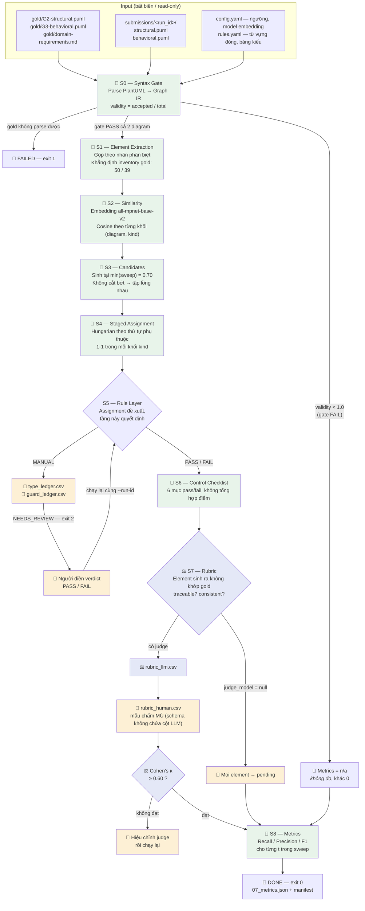
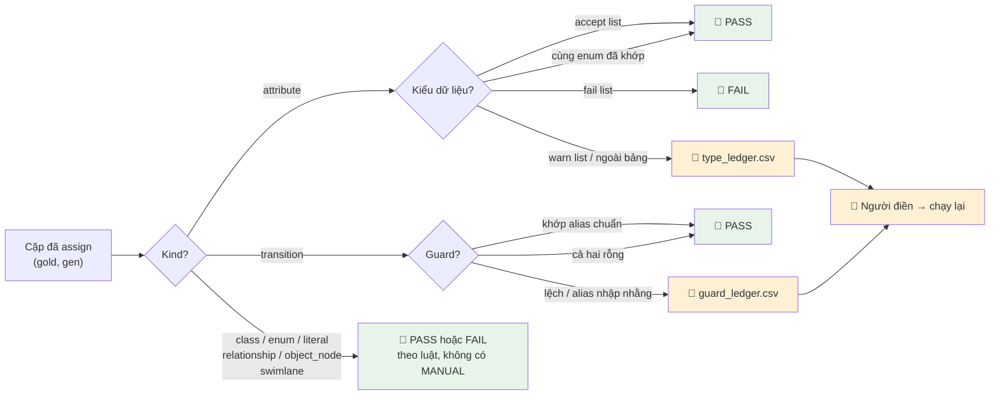

# Workflow — ModelsGrading (M2 Models Grading)

Tài liệu này mô tả toàn bộ pipeline chấm `structural.puml` và `behavioral.puml`
của một submission so với gold model đã đóng băng.

> **Đường dẫn hiện tại:** `run/` và `review/` trong các sơ đồ nằm ở
> `<RUN>/grading/models/{run,review}/` (thư mục RUN do người gọi chỉ định, ví dụ
> `generated/RUN_x`), submission truyền bằng `--submission`, còn gold và domain
> input lấy từ mục `gold:` của `config.yaml`. Xem [README.md](README.md).

Ký hiệu trong mọi sơ đồ dưới đây:

- 🤖 **tự động** — pipeline tự chấm, không cần người.
- 🧑 **cần người** — pipeline ghi file review rồi **dừng**, trả `NEEDS_REVIEW` (exit 2).
- ⚖️ **LLM judge + người** — LLM chấm trước, người chấm mù một mẫu để tính κ.

Nguyên tắc nền: **pipeline không bao giờ chờ input**. Stage nào cần người sẽ ghi
file vào `review/<run_id>/`, thoát ngay. Người điền file, chạy lại cùng
`--run-id`, pipeline đọc tiếp từ cache.

---

## 1. Toàn cảnh pipeline



---

## 2. Chỗ nào tự động, chỗ nào cần người

| Stage | Việc | Ai chấm |
| --- | --- | --- |
| **S0** Syntax Gate | Parse PlantUML, tính `validity` | 🤖 Hoàn toàn tự động |
| **S1** Elements | Gộp theo nhãn, kiểm inventory gold | 🤖 Hoàn toàn tự động |
| **S2** Similarity | Embedding + cosine | 🤖 Hoàn toàn tự động |
| **S3** Candidates | Lọc theo ngưỡng thấp nhất | 🤖 Hoàn toàn tự động |
| **S4** Assignment | Hungarian theo tầng phụ thuộc | 🤖 Hoàn toàn tự động |
| **S5** Rule Layer | PASS / FAIL theo luật | 🤖 Tự động — **trừ** `MANUAL` |
| **S5** `MANUAL` | Kiểu dữ liệu lạ, guard không khớp alias | 🧑 **Người quyết**, qua 2 ledger CSV |
| **S6** Control | 6 mục checklist | 🤖 Hoàn toàn tự động |
| **S7** Rubric | Element ngoài gold: traceable + consistent | ⚖️ LLM chấm, 🧑 người chấm mù mẫu κ |
| **S8** Metrics | Recall / Precision / F1 / diagnostics | 🤖 Hoàn toàn tự động |

### Chỉ có hai loại input của người

1. **Ledger phán quyết** (`type_ledger.csv`, `guard_ledger.csv`) — cặp mà tầng
   luật không tự quyết được. Verdict chỉ nhận `PASS` hoặc `FAIL`; giá trị khác
   làm abort toàn run (có chủ ý — không đoán ý người).
2. **Mẫu rubric mù** (`rubric_human.csv`) — để tính κ với LLM judge. Schema file
   này **không có** cột nào của LLM: tính mù được bảo đảm bằng cấu trúc, không
   bằng kỷ luật người chấm.

Người **chỉ phán quyết một lần**, tại ngưỡng sweep thấp nhất. Vì tập candidate ở
ngưỡng cao hơn là tập con của ngưỡng thấp hơn, phán quyết đó dùng lại được cho
cả bốn ngưỡng — chạy sweep **không** sinh thêm dòng ledger nào.

---

## 3. Chi tiết tầng luật S5 (nơi duy nhất tự động có thể nhường cho người)



Điểm quan trọng: cặp **FAIL ở tầng luật không phải là match**. Nó không vào
`matched`, nên không vào tử số nào. Và nó **không** được chấm lại ở rubric —
rubric dành cho element sinh ra *không có cặp PASS nào*, không phải đường cứu
cho cặp đã bị tầng luật loại.

---

## 4. Vòng đời một lần chấm (resumable)

```mermaid
sequenceDiagram
    actor U as Người chấm
    participant P as run.py
    participant R as run/&lt;run_id&gt;/ (cache, xoá được)
    participant V as review/&lt;run_id&gt;/ (người viết, version-controlled)

    U->>P: python run.py --run-id SUB-01
    P->>R: S0…S4 → ghi cache JSON
    P->>P: S5 tầng luật
    alt Có cặp MANUAL
        P->>V: ghi type_ledger.csv / guard_ledger.csv
        P-->>U: NEEDS_REVIEW (exit 2) + đường dẫn file
        U->>V: điền cột verdict (PASS / FAIL)
        U->>P: chạy lại --run-id SUB-01
        P->>R: đọc lại cache S0…S4 (không tính lại embedding)
        P->>P: S5 đọc verdict từ ledger
    end
    P->>P: S6 checklist → S7 rubric
    alt Rubric còn pending
        P->>V: ghi rubric_human.csv (mẫu mù)
        P-->>U: NEEDS_REVIEW (exit 2)
        U->>V: chấm mù mẫu
        U->>P: chạy lại
    end
    P->>R: S8 → 07_metrics.json + manifest
    P-->>U: DONE (exit 0)
```

**Hai thư mục, hai vai trò khác nhau:**

- `run/<run_id>/` — cache dùng một lần. Xoá đi chạy lại phải ra **đúng cùng kết
  quả**. Không commit (đã có trong `.gitignore`).
- `review/<run_id>/` — do người viết, có version control. Pipeline **không bao
  giờ ghi đè một ô đã điền**.

---

## 5. Exit code

| Code | Nghĩa |
| --- | --- |
| `0` | `DONE` — chấm xong, có metrics |
| `1` | `FAILED` — lỗi thật (gold không parse, inventory sai, verdict không hợp lệ) |
| `2` | `NEEDS_REVIEW` — đang chờ người; đường dẫn file review in ra stdout |

Lưu ý: **gate syntax fail không phải `FAILED`**. Submission sai cú pháp vẫn là
một kết quả chấm hợp lệ — metrics ghi `n/a` (không đo), và `n/a` luôn khác `0`
(đo rồi, không khớp gì) suốt toàn pipeline.

### Cờ `--on-pending`

| Giá trị | Hành vi khi còn mục chờ người |
| --- | --- |
| `halt` (mặc định) | Dừng, trả `NEEDS_REVIEW` |
| `provisional` | Chạy tiếp với mặc định `not_covered`, đánh dấu kết quả là tạm |

---

## 6. Những gì pipeline **không** làm

Theo spec, có chủ ý:

- Không có **điểm tổng hợp có trọng số** (kiểu `0.35*F1_node + …`). Sáu mục
  checklist và các metrics được báo riêng.
- Không có **cosine dedup**: danh tính element là **nhãn phân biệt**, không phải
  độ gần ngữ nghĩa. `dedup_threshold` cố tình không tồn tại trong config.
- Không có **Requirements Grading** và hai metric **VMX** — ngoài phạm vi.
- Hai diagram được chấm **độc lập**; không có ma trận giữa các element sinh ra.
- **Không số liệu ảnh hưởng kết quả nào nằm trong source code** — tất cả ngưỡng
  và từ vựng đóng ở YAML, có lint AST trong CI kiểm tra.

---

## 7. Các mục còn mở (quyết định của người, trước lần chấm chính thức)

| Mục | Nội dung |
| --- | --- |
| §16.2 | Đóng băng bảng tương thích kiểu (`type_table`) — hiện là bản nháp |
| §16.3 | Chạy sweep ngưỡng như một phân tích độ nhạy riêng trước khi công bố `threshold_models` |
| §16.4 | Chốt `kappa_pool`: `per_section` hay `pooled` |
| §16.5 | Xác nhận cách giải alias guard trên submission thật trước khi tin bộ đếm `guard` |
| — | `config.judge_model` đang là `null` → rubric chưa hoạt động, mọi element ngoài gold ở trạng thái pending |

Mỗi mục trên đều làm thay đổi một con số đã công bố, nên được để nguyên như spec
đặt ra thay vì tự quyết.
