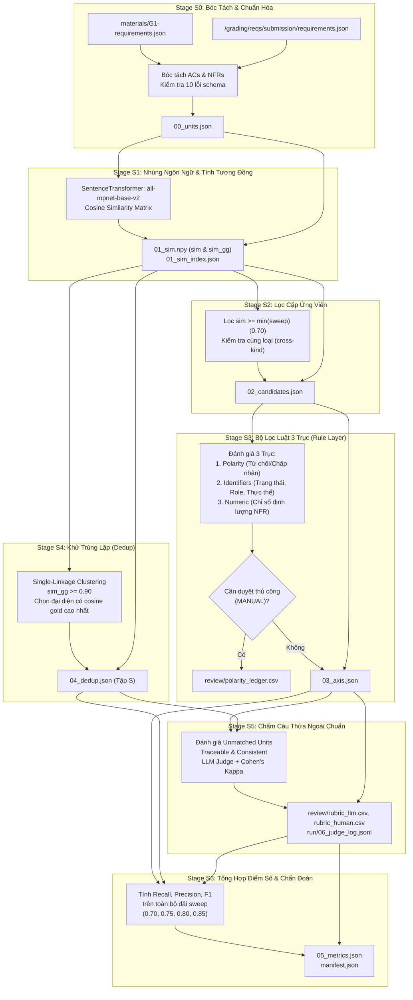

# RequirementsGrading — Kiến Trúc & Hướng Dẫn Vận Hành

Tài liệu đặc tả kiến trúc, thuật toán và hướng dẫn sử dụng cho module **RequirementsGrading** thuộc hệ thống **SWELAB Empirical Benchmark Pipeline**.

---

## 1. Giới Thiệu & Mục Tiêu

Module **RequirementsGrading** được thiết kế để tự động hóa quá trình đánh giá chất lượng các yêu cầu phần mềm do **LLM Agent** sinh ra (`requirements.json`) dựa trên đối sánh với tập yêu cầu chuẩn do chuyên gia viết (**Gold Standard** `materials/G1-requirements.json`).

### Hai chỉ số cốt lõi

| Chỉ số | Ý nghĩa kỹ thuật | Câu hỏi đánh giá |
|---|---|---|
| **Requirement Recall** | Tỷ lệ yêu cầu chuẩn (Gold) được AI đáp ứng đúng ngữ nghĩa | *AI có làm đủ bài không? Có bỏ sót tính năng nào không?* |
| **Requirement Precision** | Tỷ lệ yêu cầu do AI sinh ra là đúng và có căn cứ thực tế | *AI có bịa đặt tính năng vô lý không (hallucination)?* |

```math
\text{Recall} = \frac{\text{Số đơn vị Gold được cover thành công}}{\text{Tổng số đơn vị Gold}}
```

```math
\text{Precision} = \frac{\text{Số đơn vị sinh ra khớp Gold} + \text{Số đơn vị hợp lệ theo Rubric}}{\text{Tổng số đơn vị sinh ra duy nhất (sau khử trùng lặp)}}
```

```math
\text{F1} = 2 \times \frac{\text{Precision} \times \text{Recall}}{\text{Precision} + \text{Recall}}
```

---

## 2. Luồng Xử Lý 7 Giai Đoạn (Stages S0 – S6)

Quy trình hoạt động được tổ chức theo mô hình **Resumable Pipeline** (không chặn terminal khi cần đánh giá thủ công, lưu trạng thái qua file JSON/NPY):



---

## 3. Chi Tiết Các Giai Đoạn

### Stage S0 — Unit Extraction & Normalization
- **Bóc tách**: Mỗi User Story sinh ra các đơn vị Acceptance Criteria (`kind == "ac"`). Mỗi yêu cầu phi chức năng sinh ra một đơn vị statement (`kind == "nfr"`).
- **Chuẩn hóa chuỗi (`text_norm`)**:
  1. Loại bỏ các ký tự định dạng Markdown (`*`, `_`, `` ` ``).
  2. Gom cụm khoảng trắng liên tiếp thành 1 dấu cách đơn.
  3. Cắt tỉa khoảng trắng đầu/cuối.
  4. Cắt bỏ dấu chấm `.` cuối câu nếu có.
  > [!IMPORTANT]
  > **Không được lowercase văn bản.** Các danh từ chỉ vai trò (`Customer`, `OrderStaff`, `Accountant`) phân biệt hoa thường nghiêm ngặt.
- **Phát hiện 10 lỗi schema**: Bắt các lỗi `id_pattern`, `id_duplicate`, `ac_below_minimum` ($< 3$ ACs), `ac_on_nfr`, `empty_text`, `newline_in_field`, `missing_member`, v.v.

---

### Stage S1 & S2 — Similarity & Candidate Generation
- Sử dụng mô hình nhúng câu hiện đại: `sentence-transformers/all-mpnet-base-v2`.
- Sinh 2 ma trận tương đồng cosine:
  - $\text{sim}$: Kích thước $(N_{\text{gold}}, M_{\text{gen}})$ dùng để tìm cặp tương đồng Gold – Gen.
  - $\text{sim}_{gg}$: Kích thước $(M_{\text{gen}}, M_{\text{gen}})$ dùng để phân tích trùng lặp nội bộ bài làm.
- **Không cắt tỉa (No Truncation)**: Mọi cặp có $\text{cosine} \ge \min(\text{sweep})$ (mặc định $0.70$) đều được lưu vào tập ứng viên nhằm tránh bỏ sót bằng chứng đánh giá.

---

### Stage S3 — Bộ Lọc Luật 3 Trục (Rule Layer)

Dù hai câu có độ tương đồng ngữ nghĩa cao, chúng bắt buộc phải vượt qua 3 bài kiểm tra logic trong [`rules.yaml`](rules.yaml):

1. **Trục 1: Phân Cực Hành Động (Polarity)**
   - **Mẫu từ chối (Reject)** được quét trước: `rejects?`, `leaves unchanged`, `registers no`, `does not`, `cannot`, `is not allowed`.
   - **Mẫu chấp nhận (Accept)**: `sets ... to`, `records?`, `stores?`, `accepts?`, `registers`.
   - Nếu một câu là *Chấp nhận* còn câu kia là *Từ chối* $\rightarrow$ **FAIL(polarity)** ngay lập tức.
   - Nếu AI dùng cách hành văn lạ nằm ngoài tập từ khóa $\rightarrow$ Gán nhãn `MANUAL` để người duyệt qua file `polarity_ledger.csv`.

2. **Trục 2: Thực Thể, Trạng Thái & Hướng Chuyển Đổi (Identifiers & Direction)**
   - **2a. Chuyển trạng thái**: Bắt mẫu `from (STATUS) to (STATUS)`. Cặp `(pending, filled)` khác hoàn toàn `(filled, pending)`.
   - **2b. Tập từ khóa định danh**: Kiểm tra tập hợp các trạng thái (`submitted`, `pending`, `filled`, `shipped`, `closed`, `issued`, `paid`, `completed`, `failed`), phương thức thanh toán (`bank`, `card`, `cash`), thực thể (`order`, `invoice`, `payment`) và vai trò viết hoa (`Customer`, `OrderStaff`, `Accountant`).
     > [!TIP]
     > **Bẫy nghiệp vụ**: Hóa đơn chuyển sang trạng thái `paid`, nhưng khoản thanh toán phải là `completed`. Nếu AI viết *"payment becomes paid"* sẽ bị đánh trượt.
   - **2c. Số lượng / Cardinality**: Chuẩn hóa `no more than one`, `zero or one` $\rightarrow$ `at most one`. Kiểm tra số lượng phân bố giữa Gold và Gen.

3. **Trục 3: Số Liệu & Ngưỡng Định Lượng (Numeric Values & Thresholds)**
   - Áp dụng riêng cho các câu NFR.
   - Trích xuất chính xác cặp `(giá trị, đơn vị)` và từ chỉ hướng (ví dụ: `2 seconds`, `95%`, `200 users`, `20 submissions per second`, `TLS 1.2`, `15 minutes`).

---

### Stage S4 — Khử Trùng Lặp (Deduplication)
- Sử dụng thuật toán **Single-Linkage Clustering** trên ma trận $\text{sim}_{gg}$ với ngưỡng $\ge 0.90$.
- Trong mỗi cụm câu trùng lặp:
  1. Chọn câu có độ tương đồng cao nhất với bất kỳ câu Gold nào làm **câu đại diện (representative)**.
  2. Hòa điểm giải quyết bằng `unit_id` tăng dần.
- Các câu còn lại bị đánh dấu `redundant` và loại khỏi mẫu số của chỉ số Precision để chống việc AI "spam" các câu tương tự nhau nhằm tăng điểm.

---

### Stage S5 — Rubric Cho Các Câu Ngoài Đáp Án Chuẩn
- Áp dụng cho các câu do AI sáng tạo thêm mà không khớp với bất kỳ câu Gold nào ở ngưỡng chính ($0.75$).
- Chấm trên 2 điều kiện:
  1. **Traceable**: Có căn cứ thực tế từ bản mô tả bài toán, không phải tính năng tự biên tự diễn.
  2. **Consistent**: Không mâu thuẫn với bất kỳ quy tắc nào của bài toán.
- **LLM Judge** (cùng `ModelsGrading/judge.py`: `judge_model`, `judge_api_base`, `judge_api_key`, `temperature = 0`) chấm **toàn bộ** tập unmatched, ghi `review/rubric_llm.csv`; mỗi lần gọi (prompt + phản hồi thô) ghi vào `run/06_judge_log.jsonl`. Hàng đã chấm đủ hai điều kiện được dùng lại, không gọi lại judge.
- **Mẫu người chấm mù** (`review/rubric_human.csv`, schema không có nhãn của judge): rút `kappa_sample_size` đơn vị bằng `random_seed` từ các đơn vị chưa nằm trong vòng nào của `review/kappa_rounds.json`. Rút xác định theo seed và tập đơn vị, nên chạy lại hỏi đúng mẫu cũ, không phải lô mới.
- **Cohen's κ** giữa judge và người trên nhãn `traceable AND consistent`; `κ >= kappa_accept` thì nhãn của judge được chấp nhận (`kappa_accepted`). Báo trong `05_metrics.json` và report.
- Không có `judge_model`: các đơn vị unmatched chưa được chấm, nên `NEEDS_REVIEW` (halt) hoặc tính là trượt rubric (provisional, Precision là cận dưới).

---

### Stage S6 — Tổng Hợp Chỉ Số (Metrics & Diagnostics)
- Xuất dữ liệu chi tiết ra `05_metrics.json`.
- Báo cáo chẩn đoán bao gồm:
  - `axis_rejections`: Số lượng cặp bị từ chối do sai phân cực, sai từ khóa, hoặc sai số liệu.
  - `cross_us_matches`: Các câu đúng nội dung nhưng xếp nhầm User Story.
  - `dedup_removed`: Số câu trùng lặp đã bị lược bỏ.
  - `ac_per_story` & `ac_length`: Phân bố độ dài và số lượng tiêu chí trên mỗi story.

---

## 4. Cấu Trúc Thư Mục & Tệp Tin

Module không có workspace riêng: mọi thứ nó ghi nằm trong **thư mục RUN** do người
gọi chỉ định (ví dụ `generated/RUN_x`), tại `<RUN>/grading/reqs/`. Gold lấy từ mục
`gold:` của `config.yaml` (`gold.requirements`).

```text
evaluators/RequirementsGrading/
├── README.md               # tài liệu này
├── rules.yaml              # Closed vocabularies, regexes, normalization
├── config.py               # Loader cấu hình nghiêm ngặt (không dùng magic numbers)
├── models.py               # Các cấu trúc dữ liệu Unit, Candidate, AxisResult
├── run.py                  # grade() + CLI điều phối toàn bộ pipeline
├── stages/                 # Mã nguồn của 7 stages (s0_units.py -> s6_metrics.py)
└── tests/test_grading.py   # Unit tests bộ luật + chạy pipeline (identity, dedup, cache)

<RUN>/grading/reqs/
├── submission/requirements.json   # bản sao đầu vào (evaluator đặt vào)
├── run/                           # Disposable cache (xóa đi chạy lại ra cùng kết quả)
│   ├── 00_units.json
│   ├── 01_sim.npy, 01_sim_index.json
│   ├── 02_candidates.json
│   ├── 03_axis.json
│   ├── 04_dedup.json
│   ├── 05_metrics.json
│   ├── 06_judge_log.jsonl
│   └── manifest.json
└── review/                        # Do con người điền (giữ lại, không xóa)
    ├── polarity_ledger.csv
    ├── rubric_llm.csv                 # nhãn của judge cho mọi đơn vị unmatched
    ├── rubric_human.csv               # mẫu mù cho κ
    └── kappa_rounds.json              # các vòng κ đã dùng (loại khỏi mẫu sau)
```

`manifest.json` được ghi khi chạy xong (`DONE`) và cả khi dừng chờ review (`NEEDS_REVIEW`);
phần `config` của nó chỉ chứa các khóa mà module này đọc (không có `judge_api_key`).

Chỉ stage S1 (embedding) được cache giữa các lần chạy; cache chỉ được dùng lại khi
`digest` trong `01_sim_index.json` khớp với văn bản gold + gen và model embedding.
Các stage còn lại rẻ nên luôn tính lại, nhờ đó verdict người điền vào `review/` luôn
được đọc ở lần chạy kế tiếp.

---

## 5. Hướng Dẫn Sử Dụng

### 1. Qua pipeline chính (`main.py`)

```bash
# Chấm cả 3 module (reqs, models, vmx) trên một run đã sinh
python main.py --phase grade --run-id <run_id>

# Chỉ chấm requirements
python main.py --phase grade --grade reqs --run-id <run_id>

# Dừng và ghi file review cho người thay vì dùng mặc định
python main.py --phase grade --grade reqs --on-pending halt --run-id <run_id>
```

`--phase grade` chấm thư mục `evaluation.generated` trong `config.yaml`; `--phase all`
sinh rồi chấm luôn. `--on-pending` mặc định là `provisional`.

### 2. Chạy module riêng

```bash
python -m evaluators.RequirementsGrading.run --submission <dir có requirements.json>     --out generated/RUN_x [--run-id ID] [--on-pending halt|provisional]     [--stage all|S0..S6] [--force]
```

`--force` buộc tính lại embedding. `--stage` dừng sau stage chỉ định (để debug).

### 3. Ý nghĩa mã thoát (Exit Codes)

| Exit Code | Trạng thái | Ý nghĩa |
|---|---|---|
| `0` | `DONE` | Quy trình hoàn tất thành công, bảng điểm là kết quả cuối cùng. |
| `2` | `NEEDS_REVIEW` | Có câu cần chuyên gia mở file CSV trong `review/` để nhập `PASS`/`FAIL`; không có `05_metrics.json` cho đến khi xong. |
| `1` | `FAILED` | Lỗi nghiêm trọng (file JSON hỏng, thiếu file Gold, config sai). |

---

## 6. Quy Trình Phối Hợp Toàn Bộ Pipeline

Ba module chấm độc lập, cùng ghi vào thư mục RUN:

| Module | Cờ `--grade` | Kết quả |
|---|---|---|
| RequirementsGrading | `reqs` | `grading/reqs/run/05_metrics.json` |
| ModelsGrading | `models` | `grading/models/run/07_metrics.json` |
| VMXGrading | `vmx` | `grading/vmx/run/03_metrics.json` |

`python main.py --phase all --run-id <run_id>` sinh tài liệu vào `generated/<run_id>/`
rồi chấm cả ba, và ghi báo cáo thô `report_<tên thư mục run>.json` cùng bản text `.txt` (render từ JSON bằng `report_to_txt.py`) cạnh chúng; chạy nhiều lần với cờ `--grade` khác nhau thì báo cáo gộp, không ghi đè.
